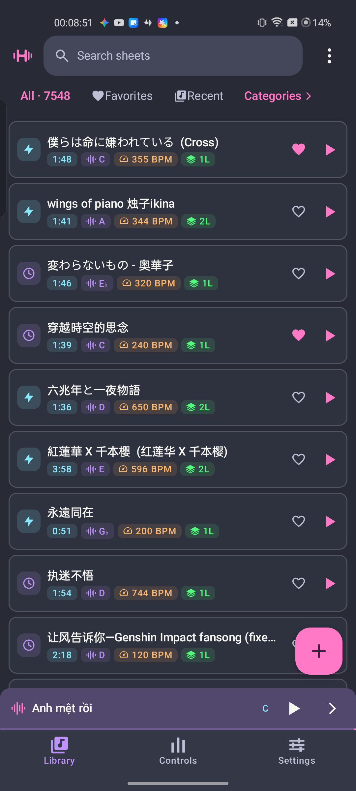
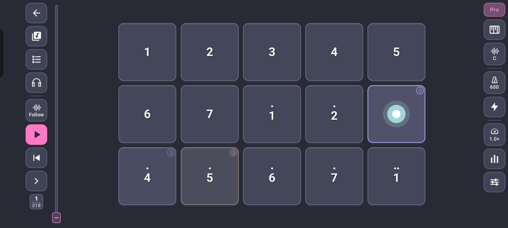

# HEURIX FLOW

**Trợ lý chơi nhạc tự động & luyện đàn 15 phím dành cho *Sky: Children of the Light***

HEURIX FLOW giúp bạn thưởng thức và luyện tập những bản nhạc yêu thích ngay trong thế giới Sky với độ mượt tự nhiên, thao tác điều khiển nổi tối giản không che khuất tầm nhìn, cùng không gian luyện đàn 15 phím riêng ngay trong ứng dụng.

---

## Tính năng nổi bật

- **Thư viện nhạc thông minh & mượt mà**
  - Tìm kiếm tức thì theo tên bài, lọc nhanh theo **Yêu thích**, **Gần đây** hoặc **Danh mục** cá nhân.
  - Hiển thị trực quan thời lượng, tông nhạc, nhịp độ (BPM), số lớp nhạc và chế độ chơi phù hợp cho từng bài.
  - Nghe thử giai điệu trước khi phát ngay trong thư viện; hỗ trợ nhập từng bài hoặc cả thư mục nhạc nhanh chóng.

- **Chơi nhạc tự nhiên với 3 sắc thái**
  - Hỗ trợ **Chạm nhanh**, **Giữ ngắn** và **Giữ ngân trọn nốt** cho cảm giác biểu diễn có hồn, đúng nhịp.
  - Dễ dàng điều chỉnh tốc độ chậm/nhanh hoặc bật/tắt từng lớp nhạc (giai điệu chính, bè đệm) theo ý muốn.

- **Bảng điều khiển nổi siêu gọn ngay trên màn hình game**
  - Hỗ trợ 2 phong cách thao tác linh hoạt theo thói quen của bạn:
    - **Thanh 2 nút nhanh**: Chạm phát/tạm dừng tức thì 1 chạm và mở bảng điều khiển riêng biệt, không bấm nhầm.
    - **1 bong bóng thu gọn**: Tối giản diện tích tối đa trên màn hình game; chạm để mở bảng, bấm phát là tự thu nhỏ lại.
  - Đầy đủ công cụ nhanh ngay trên bảng nổi: tua đoạn, đổi tốc độ, chọn **Lặp 1 lần / Lặp vô hạn**, **Tự động chuyển bài kế tiếp** và đổi bài nhanh.
  - Tự động tạm dừng an toàn khi bạn chạm vào màn hình hoặc thoát ra ngoài để không gây rối thao tác trong game.

- **Không gian luyện đàn trực quan (Studio 15 phím)**
  - Chuyển đổi nhiều âm sắc nhạc cụ quen thuộc (Piano, Harp, Flute, Guitar, Violin).
  - Có chế độ dẫn nốt trực quan và tập theo từng bước giúp bạn dễ dàng tự đánh lại bài hát yêu thích.

- **Hỗ trợ song ngữ đầy đủ**: Giao diện hoàn chỉnh bằng **Tiếng Việt** và **Tiếng Anh**.

---

## Hình ảnh thực tế trên ứng dụng

| Thư viện nhạc | Bảng điều khiển |
| :---: | :---: |
|  |  |

| Cài đặt & Tùy biến | Studio luyện đàn 15 phím |
| :---: | :---: |
|  |  |

---

## Hai phiên bản phát hành Beta

1. **Bản Tiêu chuẩn (Gọn nhẹ)**: Dành cho bạn muốn cài nhanh, nhẹ máy và tự thêm các bản nhạc riêng.
2. **Bản Tích hợp sẵn kho nhạc**: Bộ sưu tập hàng nghìn bản nhạc đã được đóng gói sẵn ngay trong ứng dụng — cài đặt và mở lên là có thể thưởng thức ngay mà không cần tải thêm tệp rời.

---

## Bắt đầu nhanh trong 3 bước

1. **Cài đặt ứng dụng** và mở lên (cần kết nối mạng ở lần đầu để xác nhận bản thử nghiệm hợp lệ và kiểm tra cập nhật mới).
2. Vào mục **Cài đặt** → cấp quyền **Hiển thị trên ứng dụng khác** và **Trợ năng**, sau đó mở game và **Căn chỉnh 15 phím** khớp với đàn trong game.
3. Chọn bài nhạc yêu thích, nhấn **Phát** trên bảng điều khiển nổi và thưởng thức.
