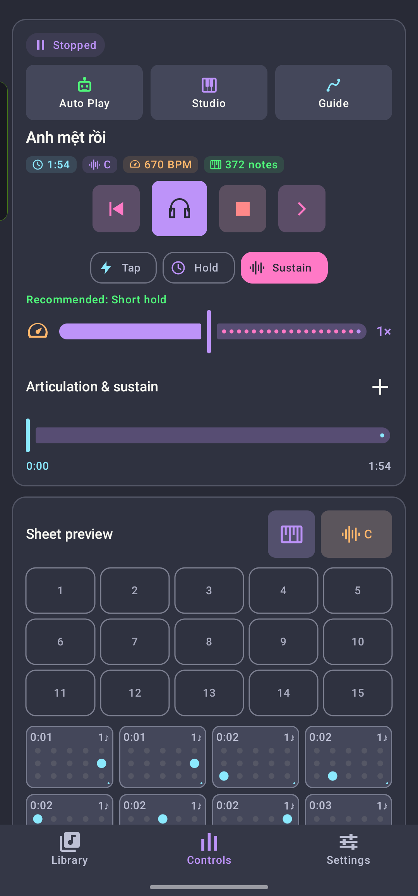
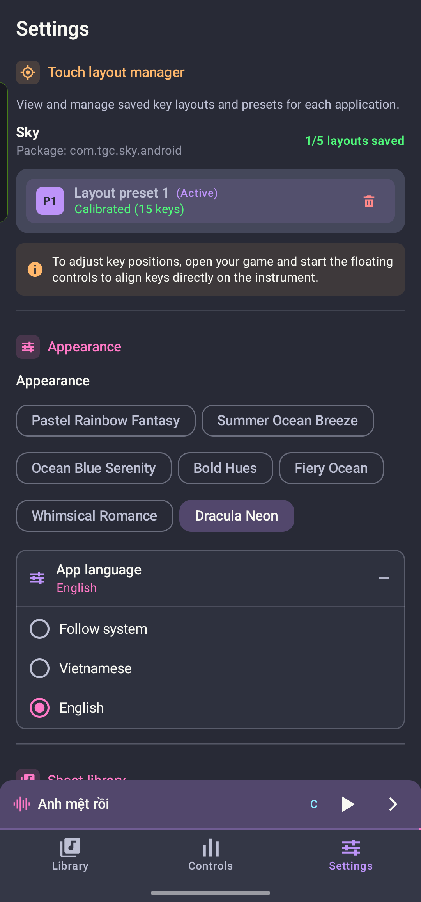

# HEURIX FLOW

### The Next-Generation Musical Companion & 15-Key Practice Studio for *Sky: Children of the Light*

Perform expressive arrangements effortlessly in-game, curate thousands of sheets in seconds, and master any melody with interactive visual guidance — all inside a sleek, distraction-free experience.

---

## ✨ Why Players Love HEURIX FLOW

### 🎵 Expressive Performance, Never Robotic
Bring every song to life with three natural touch styles — **Quick Tap**, **Short Hold**, and **Full Sustain**. Fine-tune playback speed from slow practice tempos to full performance pace, and toggle individual melody or accompaniment layers on the fly.

### 🫧 Unobtrusive Floating Overlay Built for Gameplay
Keep your focus on the world around you with a whisper-thin floating controller that never gets in the way:
- **Two Signature Control Styles**: Switch anytime between the ultra-fast **2-Button Quick Pill** (instant one-tap Play/Pause alongside a dedicated Menu trigger) or the minimalist **Single Bubble** mode.
- **On-the-Fly Control**: Adjust tempo, scrub through sections, switch tracks, toggle **Repeat (`Off` / `1×` / `Continuous`)**, or enable **Auto-Play Next** directly from the floating panel without ever leaving the game.
- **Smart Interruption Protection**: Automatically steps aside the moment you touch the game screen or switch apps, keeping your movement and camera seamless.

### 📚 Instant Library for Massive Collections
Effortlessly browse thousands of sheets with zero stutter. Search instantly by title, filter by **Favorites**, **Recent**, or custom **Categories**, inspect BPM, musical key, duration, and layers at a glance, and audition melodies with built-in audio preview before you play.

### 🎹 Built-in 15-Key Instrument Studio
Practice offline anytime with realistic instrument voices (**Piano**, **Harp**, **Flute**, **Guitar**, and **Violin**). Follow falling note trails and step-by-step visual cues to learn songs by heart before performing live with friends.

---

## 📱 Product Showcase

| Music Library | Playback Controls | Preferences & Customization |
| :---: | :---: | :---: |
|  |  |  |

 

| 15-Key Practice Studio |
| :---: |
|  |

---

## 📦 Choose Your Beta Edition

Both editions include the full feature set and receive automatic in-app update checks:

| Edition | Download Package | Best For |
| :--- | :--- | :--- |
| **Standard Edition** *(Lightweight)* | `heurix-flow-0.2.0-beta.2-no-sheets.apk` | Players who prefer a compact install and already maintain their own personal song collection. |
| **Full Pack Edition** *(Pre-Loaded Library)* | `heurix-flow-0.2.0-beta.2-with-sheets.apk` | Players who want **7,150+ ready-to-play sheets** built right into the app — install once, open, and play immediately with no separate file extraction required. |

👉 **[Download from the Beta Release Page](https://github.com/nguyendevwk/heurix-flow-beta/releases/tag/v0.2.0-beta.2)**

---

## 🚀 Getting Started in 3 Simple Steps

1. **Install & Verify**: Open **HEURIX FLOW** while connected to the internet on first launch to verify your beta access and stay up to date with new releases.
2. **Quick Setup**: Enable the floating display and Accessibility permissions inside **Settings**, then align the 15-key layout once to match your device screen.
3. **Play Anywhere**: Pick any song from your library, tap **Play** on the floating controller inside *Sky*, and enjoy.

---

## 🌐 Bilingual Experience

Full interface support in **English** and **Vietnamese (Tiếng Việt)** — switch seamlessly anytime in Settings.

> *Beta Preview Notice: Access and updates are managed centrally through this release channel. When a mandatory update is released or a beta cycle concludes, the app will guide you directly to the latest version.*
